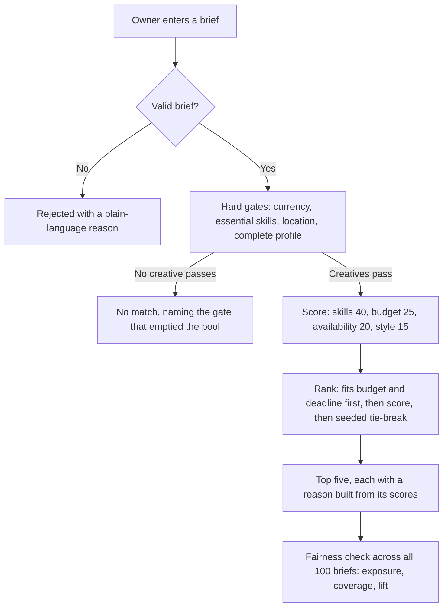

# Ditto: matching logic on synthetic data

**Status: concept and analytics prototype. All data is synthetic. There are no live users.** Nothing here shows how a real market behaves.

Live demo: (https://divyanshipurohtdigital.github.io/ditto-validation/)

## Problem

Independent creatives and small businesses spend too long finding each other. Owners sift through portfolios with no clear link between a brief and a creative's skills, rate and availability. Creatives pitch for projects that do not fit.

Hypothesis: a structured brief that returns scored, explained matches shortens the search. This build tests the logic on synthetic data. No real user has confirmed the problem. See `PRD.md`.

## Approach

Rule-based and visible, with no machine learning.

- **Score** = 40% skills + 25% budget + 20% availability + 15% style. These weights are untested starting points.
- **Hard gates** (never scored, never overridden): currency mismatch, a missing essential skill, a location the creative cannot serve, an incomplete profile.
- **Ranking:** creatives who fit budget and deadline rank first, then score, then a seeded hash, so ties never favour a creative by id or input order.
- **Reasons** are built from the stored score components, so every match states what it matched on and where it is weak.
- **Fairness check:** exposure of each creative across all 100 briefs, checked against the PRD guardrails and against a random draw among the same candidates. Scoring never reads name, email, portfolio, seniority, discipline or city.

## Process



## Results on the synthetic data

| Measure | Result | Target |
|---|---|---|
| Simulated shortlist rate (rule S1) | 19% | 80% or more. Missed |
| Most exposed creative | 16 of 100 briefs | 20% or less. Met |
| Creatives with at least one slot | 36% (73 of 200) | 50% or more. Missed |
| Reasons built from score components | 233 of 233 | 100%. Met |

Both misses come from the data. Only 19 of 100 briefs have any creative who fits budget and deadline, and only 100 of 200 creatives pass the hard gates for any brief, so 50% coverage is the ceiling. Hybrid and on-site briefs are the hardest: 17 of 55 have any candidate, against 43 of 45 remote briefs. No ranking change can fix a supply gap.

The unit economics on my hypotheses lose money: about £10 of revenue per brief against about £24 of acquisition cost. Break-even needs about 16 hires per 100 briefs, against about 5 in the base case. See `MARKET_PLAN.md`.

Test case 4 shows the engine has no exposure cap: an injected test creative who lists every skill and charges 50 GBP a day reaches 56% of briefs. The fairness check flags it. The mitigation is not built.

## Files

- `index.html`: the interface. Screen one takes a brief and shows five matches with reasons. Screen two shows the metrics. It runs in the browser with no server.
- `ditto_synth.py`: generates 200 creatives and 100 briefs from a seed.
- `ditto_match.py`: the engine, fairness check and simulated shortlist. Writes `matches.csv` and `fairness_report.json`.
- `test_cases.py`: the ten-case test plan. Results and fixes are in `TEST_LOG.md`.
- `DATA_NOTE.md`: every assumption behind the data, the engine and the shortlist rule.
- `queries.sql` and `ditto_sql.py`: the whole engine and the fairness check rebuilt in SQL (SQLite, written in standard SQL). 34 checks confirm SQL returns the same top five, funnel, exposure, shortlist and lift figures as Python, and that the data-quality queries find no violations and can detect injected bad rows. Writes six CSV tables for a BI tool.
- `analytics.js`: optional PostHog hook. Off by default. It runs only on a page address ending `?session=1`, for moderated test sessions with consent. It sends counts and flags, never personal data.
- `MARKET_PLAN.md` and `ditto_commercial_model.xlsx`: competitor fees, bottom-up market size, unit economics, regulation and a markets angle. Every model input is a hypothesis until interviews are done.
- `USER_STORIES.md`: ten built stories with acceptance criteria, mapped to tests, plus a backlog of three stories not built.
- `DECISION_MEMO.md`: why the engine is rule-based, where a model could help, and how it would be judged.
- `PRD.md`: one-page product requirements.

## Run it

```
python3 ditto_synth.py
python3 ditto_match.py
python3 ditto_sql.py
python3 test_cases.py
```

Python 3.8 or later, standard library only. Open `index.html` in any browser.

## Limitations

- All records reflect my assumptions. Results show the logic works, not that the market behaves this way.
- Effort days come from a synthetic assumption. A real intake form has no such field.
- Skill lists are self-declared and unverified. The most exposed creative lists every skill in its discipline.
- The shortlist rule tests supply, not owner behaviour.
- The page was tested in a scripted DOM, not on real devices.
- Moving to real data can introduce bias this build cannot detect.

## What I would test with real users

Interview five owners and five creatives before changing any weight. Questions: how they search today and how long it takes, what makes a match relevant, whether the reasons change their trust, and what they would pay. Collect no personal data in the app until a privacy notice with a named controller and a retention period exists.

## AI use

Built with AI assistance. The generator, engine, tests and page were written with Claude. Every number above is produced by the included scripts, and the test log records two defects the tests found.
